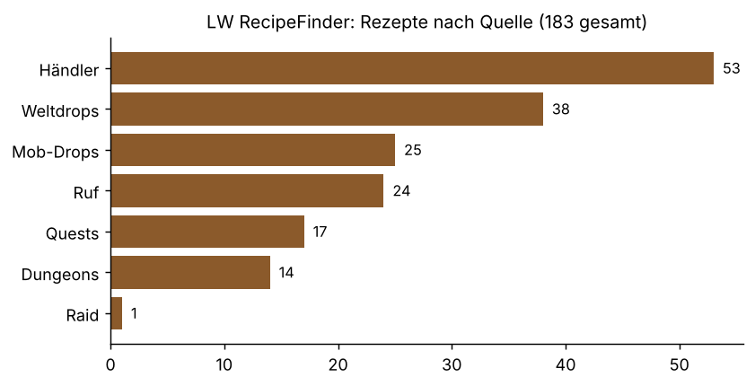
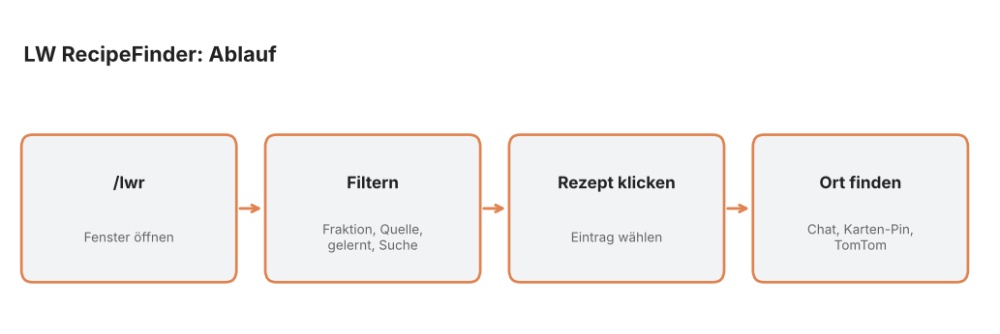

# LW RecipeFinder – Dokumentation

**WoW-Addon für Leatherworking (Lederverarbeitung)** für **WoW Forever** (Classic). Eine Liste aller Leatherworking-Rezepte zeigt sofort, **wo man welches Rezept bekommt**. Ein Klick markiert den Ort auf der Weltkarte.

> Nur Dokumentation, kein Quellcode. Autor des Addons laut Manifest: WaschBaer.

## Inhalt

| Seite | Thema |
|---|---|
| [docs/installation.md](docs/installation.md) | Installation für Forever und Classic |
| [docs/bedienung.md](docs/bedienung.md) | Fenster, Filter, Suche, Befehle |
| [docs/materialien.md](docs/materialien.md) | Materialfenster und Farmorte |
| [docs/datenmodell.md](docs/datenmodell.md) | Aufbau der Daten |
| [docs/entwicklung.md](docs/entwicklung.md) | Entwicklungsverlauf und Anpassung an Forever |
| [docs/grenzen.md](docs/grenzen.md) | Status und Grenzen |

## Ablauf

## Funktionen

- **183 Rezepte**, sortiert nach Skill-Stufe
- **Quellen:** Händler (53), Weltdrops (38), Mob-Drops (25), Ruf (24), Quests (17), Dungeons (14), Raid (1)
- **Filter** nach Fraktion, Quelle und gelernt oder nicht gelernt, dazu Suche
- **Klick auf ein Rezept:** Koordinaten im Chat, Pin auf der Weltkarte und, wenn TomTom installiert ist, ein Wegpunkt
- **Automatische Erkennung** gelernter Rezepte
- **Materialfenster** mit Materialien und Farmorten
- **Trainerliste** der eigenen Fraktion
- **Minimap-Knopf**

## Befehle

| Befehl | Wirkung |
|---|---|
| `/lwr`, `/lwrecipe`, `/lwfind` | Fenster öffnen oder schließen |
| `/lwr trainer` | Trainer der eigenen Fraktion im Chat |
| `/lwr help` | Hilfe |
