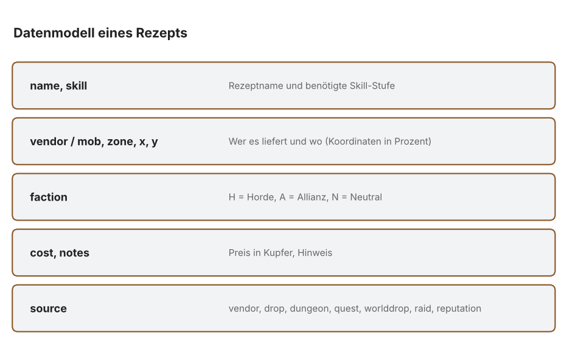
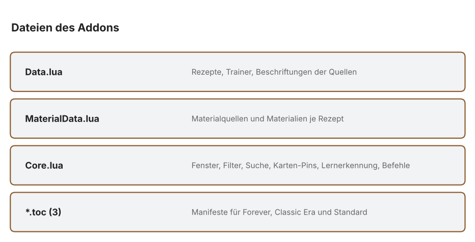

# Datenmodell

## Rezepte

Jedes Rezept hat diese Felder:

| Feld | Bedeutung |
|---|---|
| `name` | Rezeptname, zum Beispiel „Pattern: Kodo Hide Bag“ |
| `skill` | Benötigte Skill-Stufe |
| `vendor` oder `mob` | Händler oder Gegner |
| `zone` | Zone |
| `x`, `y` | Koordinaten in Prozent der Karte |
| `faction` | H = Horde, A = Allianz, N = Neutral |
| `cost` | Preis in Kupfer |
| `notes` | Hinweis, zum Beispiel „6-Slot Bag“ |
| `source` | Quelle: vendor, drop, dungeon, quest, worlddrop, raid, reputation |

## Weitere Tabellen

- **Trainer:** Trainer je Fraktion mit Ort
- **Quellenbeschriftungen:** Anzeigetexte der Quellenarten
- **Materialquellen:** Orte, an denen Materialien zu bekommen sind
- **Materialien je Rezept:** Zuordnung von Rezept zu Materialliste

## Dateien

Die Daten liegen getrennt von der Logik. Wer Rezepte ergänzen will, ändert nur die Datendateien.
